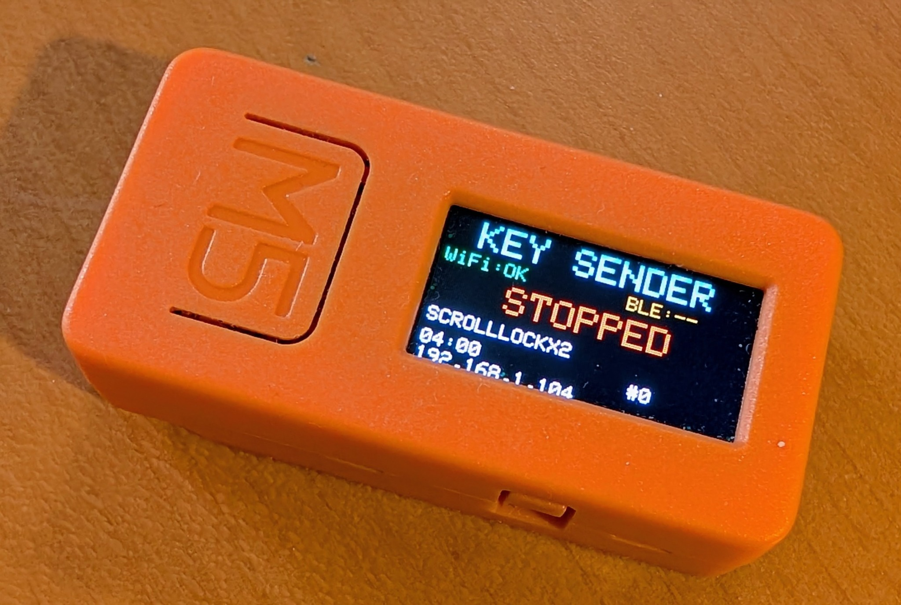
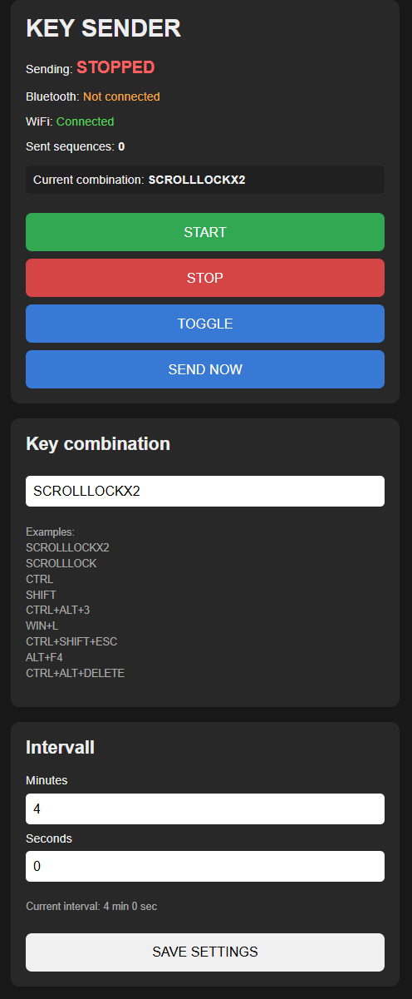

# M5Stick-KeySender

**Bluetooth LE keyboard automation for the original M5StickC — controlled over Wi-Fi.**

[](https://github.com/Nolaris-Solutions-AB/M5Stick-KeySender/releases/latest)
[](LICENSE)


Use an M5StickC as a Bluetooth keyboard that sends key combinations on demand or at a configurable interval. Control it with its built-in English-language web interface, HTTP API, or Home Assistant.

**Latest release:** [v1.0.0](https://github.com/Nolaris-Solutions-AB/M5Stick-KeySender/releases/tag/v1.0.0) · [Download source](https://github.com/Nolaris-Solutions-AB/M5Stick-KeySender/releases/latest)

> **Project status:** v1.0.0 is published. The firmware has been compiled and verified in Arduino IDE on the original M5StickC (October 23, 2026). End-to-end runtime testing of all BLE and HTTP functions has not yet been separately confirmed.

## Photos and screenshots

The original M5StickC running KEY SENDER:

<p align="center">
  
</p>

The built-in web interface:

<p align="center">
  
</p>

## Features

- Bluetooth Low Energy (BLE) HID keyboard emulation
- Responsive web interface in English
- Start, stop, toggle, and send-once commands
- Configurable repeat interval (default: 4 minutes)
- Support for key combinations such as `SCROLLLOCKX2`, `CTRL+ALT+3`, and `WIN+L`
- Immediate first send when periodic sending starts
- M5StickC button A to toggle the sender
- BLE/Wi-Fi status and transmission counter
- HTTP API for automation, including Home Assistant

## Requirements

- **Original M5StickC** (not M5StickC Plus/Plus2)
- USB connection for flashing
- Arduino IDE with an ESP32 board package supporting M5StickC
- Arduino libraries: **M5StickC** (`M5StickC.h`) and **ESP32 BLE Keyboard** (`BleKeyboard.h`)
- A 2.4 GHz Wi-Fi network and a device that can pair with a BLE keyboard

Library/board package versions are not pinned yet; please report working versions or compatibility problems in an issue.

## Quick start

1. Download [v1.0.0](https://github.com/Nolaris-Solutions-AB/M5Stick-KeySender/releases/tag/v1.0.0) or clone the repository:

   ```bash
   git clone https://github.com/Nolaris-Solutions-AB/M5Stick-KeySender.git
   ```

2. Open `firmware/KEY_SENDER/KEY_SENDER.ino` in Arduino IDE.
3. In that same folder, copy `secrets.example.h` to `secrets.h`, and set your Wi-Fi credentials:

   ```cpp
   const char* WIFI_SSID = "YOUR_WIFI_SSID";
   const char* WIFI_PASSWORD = "YOUR_WIFI_PASSWORD";
   ```

   **Never commit `secrets.h`**; it is ignored by Git.

4. Install the required libraries, select the **M5StickC** board and the appropriate serial port (for example, `COM4` on Windows).
5. **Verify** and **Upload** the sketch.
6. Pair **M5StickC KEY SENDER** with your computer using its Bluetooth settings.
7. Find the device's IP address on the display or via the Arduino Serial Monitor (115200 baud), then visit:

   ```text
   http://DEVICE_IP/
   ```

If Wi-Fi is unavailable or the credentials are incorrect, startup will wait for a connection.

## Web interface

The web interface shows sender, Bluetooth, and Wi-Fi status, a send counter, the current key combination, and the configured interval.

You can **Start**, **Stop**, **Toggle**, **Send now**, and **Save settings**. The initial configuration sends `SCROLLLOCKX2` every 4 minutes.

## HTTP API

| Method | Endpoint | Description |
|---|---|---|
| GET | `/` | Web interface |
| GET | `/api/status` | JSON status |
| GET | `/api/running` | Plain text: `1` running, `0` stopped |
| POST | `/api/start` | Start repeating and send immediately |
| POST | `/api/stop` | Stop repeating |
| POST | `/api/toggle` | Toggle repeating |
| POST | `/api/send` | Send the configured combination once |
| POST | `/api/settings` | Set `combo`, `minutes`, `seconds` parameters |

Example commands (replace `DEVICE_IP`):

```bash
curl http://DEVICE_IP/api/status
curl -X POST http://DEVICE_IP/api/toggle
curl -X POST 'http://DEVICE_IP/api/settings?combo=SCROLLLOCKX2&minutes=4&seconds=0'
```

Status fields include `sending`, `bluetooth`, `wifi`, `minutes`, `seconds`, `combo`, and `count`. Some actions require an active BLE connection and may return HTTP 503; invalid settings may return HTTP 400.

## Home Assistant example

Add to Home Assistant YAML configuration:

```yaml
rest_command:
  keysender_toggle:
    url: "http://DEVICE_IP/api/toggle"
    method: POST
```

To read status, use `GET /api/running` or `GET /api/status`. Substitute the device's local IP address.

## Security and limitations

> **Security warning:** The current web/API server has **no authentication** and uses **plain HTTP**. Anyone who can reach the device over the network can send keystrokes and change its settings. Keep it on a trusted, ideally isolated network. **Never expose port 80 to the internet.** Pair the device only with computers you are authorized to control.

Settings are stored in RAM and reset to defaults after reboot. Automatic Wi-Fi reconnection is not implemented.

## Project files

- [Firmware](firmware/KEY_SENDER/KEY_SENDER.ino)
- [Wi-Fi configuration template](firmware/KEY_SENDER/secrets.example.h)
- [Release notes](RELEASE_NOTES.md)
- [Contributing](CONTRIBUTING.md)
- [MIT license](LICENSE)

## Contributing

Bug reports, documentation updates, and improvements are welcome. Please see [CONTRIBUTING.md](CONTRIBUTING.md).

## License

MIT License — Copyright © 2026 **Nolaris Solutions AB**. See [LICENSE](LICENSE).
